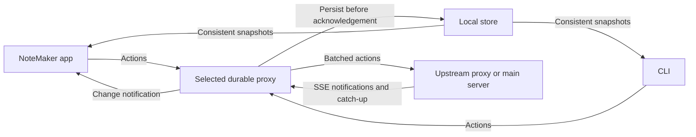

# NoteMaker

## Version control

This repository uses Jujutsu with a colocated Git repository. Git, Jujutsu, and
SSH are provided by `shell.nix`.

```sh
nix-shell
jj status
jj git fetch
jj git push --bookmark main
```

The `origin` remote is `tyler@192.168.50.129:/git-repos/NoteMaker.git` on the
Phenom II home server. Its address is assigned automatically; consult
`../computer-it/NETWORK_OPERATING_GUIDE.md` if it changes. To create another
local checkout:

```sh
jj git clone tyler@192.168.50.129:/git-repos/NoteMaker.git NoteMaker
```

Move the `main` bookmark to the commit you intend to publish before pushing.

## Android testing

Use a recent Nixpkgs channel with Android API 36 support. `shell.nix` enables
the Android SDK license and unfree packages for this shell.

```sh
nix-shell
boox-emulator
```

The launcher creates a persistent AVD on first use under `$HOME/.android/avd`
(or `$ANDROID_AVD_HOME`). It uses Android 16 / API 36 with Google APIs and an
x86_64 image for accelerated testing on an x86_64 Linux host. The portrait
1860 × 2480 display at 300 dpi approximates the BOOX Note Air6 C's 10.3-inch
screen. Its Android logical density may differ; confirm layouts on real hardware.
The emulator does not reproduce BOOX firmware, E Ink refresh, color rendering,
or stylus latency and pressure.

For automated testing, launch in a separate terminal or background process:

```sh
boox-emulator-headless &
adb wait-for-device
until [ "$(adb shell getprop sys.boot_completed 2>/dev/null | tr -d '\r')" = 1 ]; do
  sleep 2
done
adb install -r path/to/app.apk
adb shell screencap -p /sdcard/screenshot.png
adb pull /sdcard/screenshot.png
adb emu kill
```

Emulator flags can be passed through, for example `boox-emulator -wipe-data`.
Linux acceleration requires access to `/dev/kvm` (usually membership in the
`kvm` group). Use `emulator -accel-check` to check host support. For GUI use,
a working graphical session is required; headless mode supports CLI testing.
The initial `nix-shell` downloads a large SDK and system image.

References: [Nixpkgs Android tooling](https://github.com/NixOS/nixpkgs/blob/master/doc/languages-frameworks/android.section.md),
[BOOX Note Air6 C specifications](https://shop.boox.com/products/noteair6c).

## Inspecting the BOOX Notes APK

The Nix shell includes `jadx` (Java decompilation) and `apktool` (decoded
resources and Smali bytecode). USB extraction requires the tablet to authorize
this computer for USB debugging; check with `nix-shell --run 'adb devices -l'`.
Local extracted APKs, assets, and code belong in `boox-notes-decompiled/`, which
is excluded from version control. This folder's README records extraction
details and decompilation limitations when extraction is complete.

## Applications

The repository has three applications and a shared Java core:

- `apps/android`: native Android 16 note-taking app for BOOX Note Air6 C.
- `apps/server`: local HTTP server, durable SQLite operation log, and live browser viewer.
- `apps/cli`: agent-facing CLI compiled for NixOS/JVM and Android.
- `packages/core`: shared local replica, atomic actions, replay, and rendering.

Build and run everything inside the Nix environment:

```sh
nix-shell
apps/android/build.sh
python3 apps/server/server.py --database notemaker.sqlite3
```

The server listens on all interfaces at port 8765 by default. Open
`http://localhost:8765` on this computer to view a document. On the tablet, open
**More → Network settings**, enter the computer's LAN address and port (blank
port defaults to 8765), and set the document name in **Notes → Open or create
document**. Allow inbound TCP 8765 in the computer's firewall if needed. For the
emulator, use address `10.0.2.2`. Leave the server address blank for local-only
editing.
Server flags include `--host`, `--port`, and `--database`; no remote deployment is
performed. No authentication is enabled; this version is for a trusted network.

Install and launch the APK:

```sh
boox-emulator
# In another nix-shell terminal, or use your USB-connected tablet:
adb install -r apps/android/build/notemaker.apk
adb shell am start -n com.notemaker/.MainActivity
```

If more than one device is attached, add `-s <serial>` to each adb command.
The APK uses an ignored development signing key in `apps/android/build`.
Keep that key to install future builds over an existing installation. Uninstalling
the app or clearing its data removes locally stored notes and unsynced edits.

### Drawing and collaboration

The top bar holds **Notes**, **Pen**, **Erase**, and direct **Undo/Redo** controls.
Use **Notes → Browse files…** to search saved notes and tap a file to open it.
The default **Grid** view includes document previews; choose **List** for compact
rows. The chosen mode is remembered on this device. Previews show the first page
of paged notes or fit the content of an infinite canvas, and load in the background.
**Refresh** reloads both the file list and previews.
**New file** creates a named fixed page, multipage notebook, or infinite canvas;
an existing name is rejected without changing that file. The browser lists files
on the selected editing proxy (this device by default), so device files remain
available offline. **Refresh** reloads the list. Files that exist only on the
upstream server are not listed; use **Open or create document…** to open those
by name or change connection settings.
Hold a file in either browser view and choose **Delete** to delete it locally
and on the configured server when synchronization succeeds. Cancel leaves it
unchanged. Deletion works offline, cannot be undone, and reserves that document
name permanently. Other replicas learn the deletion when they synchronize;
stale offline edits cannot restore the file. The server retains its operation
log for replication and history; this is logical deletion, not secure erasure.
Upgrade the server, app, and CLI/proxies together before using deletion.
The narrow left rail groups **Template**, **Layers**, **Shapes**, **Fill**,
**Select**, **Text**, **Insert**, **Move**, **Pages**, **Agent**, and **More**.
The robot **Agent** button opens the Agent interface directly.
Both finger and stylus draw. **Pen** opens brush profiles, presets, color swatches, width and material controls;
stylus pressure varies width. Pencil grade, marker opacity, bristle density, paint
load, softness, charcoal dust, fountain flex and calligraphy nib angle are saved
on each stroke so Android, CLI exports and the browser viewer replay the same mark.
**Shapes** opens an original monochrome palette for rectangles, ellipses, arrows,
lines, triangles, diamonds, polygons, stars and 3D figures. Choose outline color,
width and optional fill, select a shape, then drag on the canvas. The completed
gesture saves one editable object through the selected proxy; canceling a shape
gesture saves nothing. **Text → Enter text…** accepts text and font size, then a
canvas tap places an editable text object. Use **Notes → Edit diagram objects…**
to change an object's geometry or text afterward. Object creation participates
in human undo/redo and remains available offline through the local proxy.

**Erase** offers whole-item, partial, area and page erasing, plus optional
scribble-to-erase. Selection and erasing follow painted coverage, including image
transparency and hollow shapes, on the selected layer only. Partial erasure keeps
the original item and adds an undoable local mask. Switching layers clears the
selection and pending gestures. **Fill** colors native objects or enclosed drawing regions.
**Select** provides transforms, copy/cut/paste, duplication and deletion, with
15-second selection leases and live previews. The top-bar **Undo/Redo** controls change
your own drawing/erasing actions and sync the result; another editor's selection
blocks conflicting operations. **Move** enables
dragging/pinch zoom and offers **Reset view** and **Return to pen**.

**Layers** opens a list of layers, topmost first, with previews,
names, and visible/hidden states. Tap a row to select it or its eye to hide/show
it locally. Use **New layer** to add a named layer. Each row's **…** menu offers
rename, duplicate, reorder, merge and archive controls, as well as
**Force visible for everyone**, shown as a lock while enabled. Release it to
restore each client's local visibility preference.

Menus use white panels with thin black rounded borders, divided action rows,
and black selection dots beneath visual choices. Opening or dismissing a panel
preserves the canvas bounds, position and zoom. Panels scroll when the display
is too short for their contents. Show a layer before drawing on it.
**Insert** contains picture, SVG and text placement; **Template** contains page
guides. **More** contains toolbar preferences, pen presets, history and Agent.
**More → Toolbar preferences → Show tool labels** persists locally; accessible
tool descriptions remain available with labels hidden.

Documents can be a fixed page, multiple numbered pages, or an infinite canvas.
Use **Pages** for previous/next/go-to actions in multipage documents. The document
name is its shared identity; clients opening the same name on the same server
receive the same strokes. An existing document retains its original type.
The browser viewer supports page selection, local visibility, and drag/scroll
navigation for infinite canvases; it is read-only.

Drawing continues offline. The app and agents share a local replica proxy with
an incremental model and durable journal. Pen input appears immediately;
**Saving on device…** means the worker has not finished persisting it. The proxy
retries synchronization while Android permits it to run and resumes when reopened. The server stores all committed
operations in SQLite, including intermediate stroke snapshots. Back up the
SQLite database with SQLite's backup facilities or while the server is stopped.
A document's saved sync cursor belongs to that server's database. The replica
pins its database identity on synchronization and rejects an unrelated database.
URL changes may reach the same server at a new address. Existing replicas acquire
this identity on their first sync after upgrade; point them at their original database.

### Integration verification

```sh
nix-shell --run 'apps/android/build.sh'
nix-shell --run 'python3 tests/server_checks.py'
nix-shell --run 'python3 tests/integration.py'
```

The test starts the real server on port 18765 and two isolated headless Android 16
emulators on ports 5580/5582. It does not modify the normal emulator's data.
It installs the APK, drives pressure-bearing input through the real Android
canvas, verifies identical event logs and PNG images, and checks concurrent edits,
layers, undo/redo, eraser, offline recovery, persistence, and document types.
It also checks live partial strokes during a system-injected finger gesture and
uses headless Chromium to verify the browser's replay and rendered coverage.
It stops its server and emulators on completion. First boot can take several
minutes; both emulators need KVM and may allocate about 6 GiB guest RAM combined,
plus host overhead (the API 36 emulator raises smaller requested allocations).
Artifacts are written to ignored `.test-artifacts/`.

Architecture decisions are in [docs/adr](docs/adr). Verification results and
hardware limitations are in [docs/verification.md](docs/verification.md).

For a focused UI review, start an emulator with `boox-emulator-headless`, then run
`nix-shell --run 'python3 tests/ui_review.py emulator-5554'` with its actual serial.
This emulator-only review installs the built APK, creates a unique
`Interface-review-*` notebook, and exercises the toolbar and anchored panels
through Android's UI automation. It temporarily overrides emulator size/density
for narrow-screen checks and resets those overrides afterward. Test notes are
retained; screenshots are saved in `.test-artifacts/ui-review/`.

For file browsing, creation, deletion, search and offline restart checks on an isolated
emulator, run `nix-shell --run 'apps/android/build.sh && python3 tests/files_android.py'`.
This uses emulator port 5590 and saves artifacts in `.test-artifacts/drawing-android/`.

### Agent CLI and editable diagrams

```sh
nix-shell
apps/cli/build.sh --android
apps/cli/notemaker --help
# Start this in a separate nix-shell and leave it running:
apps/cli/notemaker --state .test-artifacts/my-replica --document demo serve 8766
# In the client shell:
apps/cli/notemaker --proxy-file .test-artifacts/my-replica/proxy.json --document demo --actor agent-1 diagram add apps/cli/examples/diagram.json
apps/cli/notemaker --proxy-file .test-artifacts/my-replica/proxy.json --document demo --actor agent-1 svg add apps/cli/examples/placed.svg
apps/cli/notemaker --state .test-artifacts/my-replica --document demo inspect
apps/cli/notemaker --state .test-artifacts/my-replica --document demo export .test-artifacts/demo.png
apps/cli/notemaker --proxy-file .test-artifacts/my-replica/proxy.json --document demo sync http://localhost:8765
```

All app and CLI writes require a selected running proxy. Direct `--state` reads
remain available, including with the proxy stopped. `serve` owns the replica and
synchronizes automatically; `sync [UPSTREAM]` requests a synchronization pass.
The main server may be unavailable: the proxy persists edits locally and catches
up later. Separate devices use separate replicas.
Read `apps/cli/notemaker --help` for options, defaults, input/output conventions,
and quick examples; use [CLI documentation](apps/cli/README.md) for JSON schemas.
The Nix shell includes PyYAML for validating Codex skill metadata with the
skill-creator validator.
Multiple local CLI processes can share one replica and use distinct `--actor`
values. Give one agent session a stable actor ID across calls.

Diagrams contain editable rectangles, ellipses, labels, and attached arrows.
The same object model also supports lines, triangles, diamonds, pentagons,
hexagons, and stars; `apps/cli/notemaker shape list` returns the supported IDs
and names. Create and edit them using `object put` and `object update` through
the selected proxy. Upgrade app, CLI/proxies, and server together for new shapes.
On Android use **Notes → Edit diagram objects…** to edit geometry/labels or
erase/restore an object. The app and browser render the same object model.
A diagram is one atomic, undoable action for its actor. Selection leases protect
objects and ink across proxy connections; leases release on deselection or clean
disconnect and expire after 15 seconds without renewal. Transforms preview live
and commit as one action. Offline concurrent versions are preserved for the
conflict comparison panel, including edits made under the same actor identity.

The grouped Android panels include geometric and 3D shapes, text styling, pen
profiles and presets, whole-stroke/partial/area/page erasing, enclosed fill,
layer management, pictures, page templates and toolbar preferences. All content
edits use the selected proxy and remain available offline. See the
[drawing command schemas](apps/cli/README.md#drawing-tools-and-collaboration)
and [ADR 0009](docs/adr/0009-drawing-tools-and-selection.md). Handwriting-to-text
remains deferred. Pen profiles are original pressure-based renderings; the
calligraphy profiles use stroke direction and a fixed nib angle, not stylus tilt.

Generated SVGs can be placed with `svg add FILE.svg [PLACEMENT.json]`. Optional
placement JSON specifies `x`, `y`, `w`, `h`, `layer`, `page`, and `object` ID.
Each SVG remains a vector asset embedded in one movable, resizable, undoable
object, available offline on both CLI runtimes. See the [SVG import profile and
examples](apps/cli/README.md#place-a-generated-svg). Nix fetches the hash-pinned
JSVG and AndroidSVG libraries, which are bundled into the CLI/APK. Rebuild and
upgrade the app, CLI, and server together before synchronizing SVG objects.

The installed Android APK includes the CLI. `MainActivity.startCli(args)` launches
it as a child process under the app's UID and supplies its private state directory
and current document. Server agent chats use the same local-state CLI workflow. The standalone Android
DEX jar is also built for diagnostics. See [CLI usage and schema](apps/cli/README.md)
and [ADR 0003](docs/adr/0003-local-replicas-and-cli.md).

```sh
nix-shell --run 'apps/cli/build.sh --android && apps/android/build.sh'
nix-shell --run 'python3 tests/cli_checks.py'
nix-shell --run 'python3 tests/cli_android.py'
```

The Android CLI check boots one isolated API 36 emulator on port 5584, launches
CLI processes from the actual app, draws concurrently while offline, checks
actor undo/redo, PNG export, desktop/tablet reconnect and conflicts, and browser
rendering. It uses a temporary server on port 18766 and writes artifacts under
`.test-artifacts/cli-android/`. It does not use or deploy to Phenom II.

### Local proxy and primary host

The current primary host is this development computer's existing server and
`notemaker.sqlite3` database. The BOOX currently connects over the USB tunnel
described below. For Wi-Fi, the desktop's current LAN URL is
`http://192.168.50.180:8765`; configure it under **Notes → Open or create document**
after allowing the port through the desktop firewall. Addresses remain
configurable because DHCP can change them; `10.0.2.2` is for the emulator only.

The deployed primary and desktop proxy run in tmux sessions `notemaker-primary`
and `notemaker-desktop`. Inspect them with `nix-shell --run 'tmux list-sessions'`.
Do not start another copy on their occupied ports. The primary retains its Pi
configuration and existing database; the desktop replica remains at
`~/.local/state/notemaker-desktop`.

The Android app starts its local command proxy at `127.0.0.1:8766`. Its spawned
CLI uses that proxy automatically. Desktop agents can run their own cached
replica synchronized with the primary host:

```sh
nix-shell
apps/cli/build.sh --android
apps/cli/notemaker --state ~/.local/state/notemaker-desktop --document notes serve 8766 http://127.0.0.1:8765
# In another nix-shell:
apps/cli/notemaker --proxy-file ~/.local/state/notemaker-desktop/proxy.json --document notes --actor agent-1 inspect
```

To access the tablet's replica over USB, forward its local port and copy its
private connection descriptor using the authorized debugging connection:

```sh
adb -s <tablet-serial> forward tcp:18767 tcp:8766
mkdir -p .test-artifacts/tablet-proxy
adb -s <tablet-serial> exec-out run-as com.notemaker cat files/proxy.json > .test-artifacts/tablet-proxy/proxy.json
chmod 600 .test-artifacts/tablet-proxy/proxy.json
python3 - <<'PY'
import json
from pathlib import Path
p = Path('.test-artifacts/tablet-proxy/proxy.json')
d = json.loads(p.read_text())
d['url'] = 'http://127.0.0.1:18767'
p.write_text(json.dumps(d))
PY
apps/cli/notemaker --proxy-file .test-artifacts/tablet-proxy/proxy.json --document notes --actor agent-1 inspect
```

The token and replica identity survive restart in private `proxy-config.json`.
Keep the descriptor private; recopy it if the listener address changes. Android can stop background execution; force-stop ends the proxy.
Reopen the app to resume synchronization. See [proxy protocol](apps/cli/README.md#local-proxy).

For synchronization over USB with the desktop's existing server, run
`adb -s <tablet-serial> reverse tcp:8765 tcp:8765` and set the tablet's server URL
to `http://127.0.0.1:8765`. This is the current physical-tablet setup and works
with the desktop's firewall. Recreate the tunnel after reconnecting USB. Unplugged
editing remains local until the server is reachable again. For Wi-Fi sync, use
the desktop's LAN URL and allow TCP 8765 on its LAN firewall interface.

Each durable proxy has at most one upstream: the main server URL or another
proxy's descriptor file. For example, start a second proxy with
`apps/cli/notemaker --state /tmp/child --document notes serve 8767 ~/.local/state/notemaker-desktop/proxy.json`.
Use `--proxy-file /tmp/child/proxy.json configure UPSTREAM` to change its upstream;
an empty string disconnects it. New proxy links require reachable proxy ancestors
for cycle validation; existing configured replicas continue working through outages.
One main-server identity is pinned across the tree; a different server database
requires a separate replica. Forwarding-only proxies are not implemented.
Upgrade the server, app and CLI together for replication protocol 3. Preserve
the existing server database and replica files; do not run older writers against
a migrated replica.

In **Notes → Open or create document**, leave **Editing proxy URL** blank to use
the device's durable proxy, or enter a reachable proxy URL and its bearer token.
The app and spawned CLI then use that selected proxy; losing it prevents writes.
A local proxy remains usable without its upstream. Loopback proxies on other
devices are reached through an ADB/SSH tunnel. The Server URL field configures
the device proxy's upstream and the existing AI chat connection.



The first pending action starts a 500 ms upload window. Upload starts are at least
500 ms apart per proxy, with one upload in flight and batches capped at 100 actions
and approximately 3 MB. Failures back off to 30 seconds. SSE wakes downstream
replicas; idle connections send 15-second heartbeats without document polling.
Intermediate acknowledgements mean durable receipt; only main-server commits
remove provisional actions. Proxies synchronize documents opened or received
locally, rather than copying every document on the server.

Local state consists of a baseline `document-*.json` plus its `.json.journal`
file. Preserve both when backing up, with writers stopped or the document locked.
Use CLI `log` to inspect live state. Do not use an older app/CLI to write a migrated
replica. Existing notes are migrated without clearing them.

### Automated test tiers

Run the framework inside the root Nix environment. The default needs only this
computer; it never discovers or selects a physical tablet automatically.

| Tier | Coverage | External resources |
| --- | --- | --- |
| `local` (default) | Framework, server, CLI, drawing/export/browser, proxy, mock-chat, generated topology/failure tests | None; temporary local servers/proxies and Chromium |
| `emulator` | Two-client integration, drawing/selection UI, Android CLI, chat UI, 1,000-stroke performance | Local Android emulators; host graphics for performance |
| `hardware` | Installed tablet app/proxy connectivity, drained queue, logs, screenshot; optional backed-up upgrade | Explicit ADB serial and reachable configured server |
| `network` | Edits through multiple existing proxies, final server order and model convergence | Explicit server URL and at least two reachable proxy descriptors |

```sh
nix-shell --run 'python3 tests/run.py'
nix-shell --run 'python3 tests/run.py --tier local --tier emulator'
# Select a smaller emulator run, or inspect the plan without accessing devices.
nix-shell --run 'python3 tests/run.py --tier emulator --suite cli_android'
nix-shell --run 'python3 tests/run.py --tier local --suite coverage_checks'
# Focused coverage, mask rendering, layer switching and panels on an isolated emulator.
nix-shell --run 'apps/android/build.sh && python3 tests/drawing_android.py --coverage-only --panels-only'
nix-shell --run 'python3 tests/run.py --tier hardware --tier network --list'
# Focused tool-switch selection/lock-release regression on an isolated emulator.
nix-shell --run 'apps/android/build.sh && python3 tests/drawing_android.py --tool-switch-only'
```

The repository pre-commit hook runs both local and emulator tiers, excluding
the external network and physical-tablet tiers. Enable it for this checkout with
`git config core.hooksPath .githooks`. It runs through `nix-shell` and blocks a
commit if a check fails. Chat proxy-routing checks verify forwarding through a
two-proxy chain and guard Android against using the upstream URL directly.

The runner builds the required artifacts once, then schedules suites in parallel
using up to two workers by default (`--jobs 1` through `--jobs 4`). The default
is two because a four-worker probe caused heavy swap use on this host. It uses
the mean of each suite's last five completed durations to start longer work
first, with initial estimates for suites without history. In direct mode,
resource claims keep suites with overlapping emulator ports or services apart;
the performance suite runs without other emulator suites so host load does not
skew frame timings. Adjust the pool with
`--jobs 1` if host memory or CPU becomes constrained; raise to `--jobs 3` or
`--jobs 4` on a larger host. Use `--no-build` only with current build artifacts.
Existing individual scripts remain available. Each run
writes streamed suite logs and a `report.json` with pass/fail/skip outcomes in
`.test-artifacts/runs/<timestamp>/`; rolling timing history is stored alongside
these run directories. A missing serial,
network configuration, or unavailable selected tablet is a **skip**, not a pass;
`--require-resources` makes skips fail the run, suitable for a dedicated hardware
test machine. A configured network endpoint that is unreachable is a failure.
Live paid-provider testing (`tests/pi_chat.py`) and the manually selected-device
UI review remain separate opt-in commands.

To give each suite its own process, network namespace, ADB server and temporary
directory, use the rootless Docker mode. Start the daemon in one terminal, build
and load the small runtime image once, then run the same tier command with
`--containers`:

```sh
# Terminal 1
nix-shell --run notemaker-dockerd

# Terminal 2
nix-shell --run 'nix-build tests/container-image.nix --no-out-link | xargs docker load -i'
nix-shell --run 'python3 tests/run.py --tier local --tier emulator --containers --jobs 2'
```

The container mounts the source tree and `.test-artifacts` so the runner keeps
the same per-suite logs, reports, screenshots and diagnostic files. It mounts
the Nix store read-only for the shell.nix toolchain, and passes `/dev/kvm` to
emulator suites. Network and port claims are isolated between suite containers;
the performance suite remains exclusive of emulator suites because they still
share host CPU and memory. The default pool remains two; use up to four on a
host with enough memory. Containers share the host kernel and Android emulator
hardware acceleration, so this is process/network isolation rather than a VM.

Physical-device checks operate on the explicitly selected tablet. Keep it idle
during an upgrade check. A smoke check launches the app but makes no document
edits; it requires the tablet's embedded proxy to reach its configured server:

```sh
nix-shell --run 'python3 tests/run.py --tier hardware --serial SERIAL --require-resources'
# Explicit upgrade: stop app, back up APK/data, install, verify and reconnect.
nix-shell --run 'python3 tests/run.py --tier hardware --serial SERIAL --install-tablet --reverse-port 8765 --require-resources'
```

After installing the current APK, exercise drawing on the physical tablet with:

```sh
nix-shell --run 'python3 tests/tablet_drawing.py --serial SERIAL'
```

This opt-in offline check requires the embedded proxy with its upstream already
unavailable and temporarily selects a new `Drawing-check-<timestamp>` notebook.
It preserves the upstream configuration throughout the test. It tests
shape/text UI input, atomic history, cancellation, CLI-to-app updates, and
offline restart, then restores the previous notebook and connection settings.
It retains the test notebook and private reports/screenshots under
`.test-artifacts/tablet-drawing/`; it does not edit existing notebook content.
Injected input and screenshots do not measure physical stylus feel or E Ink
ghosting. Keep the tablet idle while the checks run.

`--reverse-port` explicitly creates/leaves the USB mapping used by the running
app; omit it for ordinary Wi-Fi access or an existing mapping. Upgrade checks
compare every saved file before/after installation, verify the installed APK
hash, and check the active document's action contents, server identity and actor
histories. They retain private backups and reports in `.test-artifacts/tablet/`.
Verification uses the desktop JVM CLI through a temporary ADB forward, cleaned
up afterward; it does not depend on standalone BOOX `app_process` shutdown.
This does not measure physical pen latency or E Ink refresh/ghosting.

For multiple computers, first provision and connect the desired proxy tree.
Expose its loopback endpoints through your existing SSH/ADB tunnels. Create a
private JSON config (for example, `.test-artifacts/network-lab.json`):

```json
{
  "server": "http://127.0.0.1:18765",
  "proxies": ["machine-a-proxy.json", "machine-b-proxy.json"]
}
```

Descriptor paths are relative to this config; each descriptor contains the
proxy's reachable `url` and private `token`. Keep them outside version control.

```sh
nix-shell --run 'python3 tests/run.py --tier network --topology .test-artifacts/network-lab.json --require-resources'
```

The network check validates root identities before writing, then creates one
uniquely named `test-network-*` document and an action through each proxy. It
checks all acknowledged actions reach the main server exactly once and every
replica agrees on final order and materialized model. Test documents remain for
inspection because document deletion is not supported. It does not disconnect,
crash, reconfigure, or deploy remote services; destructive fault injection stays
in the isolated local topology suite.

### Stroke rendering regressions

```sh
nix-shell --run 'apps/cli/build.sh && python3 tests/stroke_rendering_checks.py'
nix-shell --run 'apps/android/build.sh && python3 tests/drawing_android.py --ink-only'
```

The local suite compares self-crossing ink with independent crossing strokes,
including translucent ink. The Android check compares every canvas pixel during
live emission, at pen-up, after local persistence, and after rebuilding the cache.
It covers all eleven brushes, overlapping content, zoom, and fractional panning.
`--ink-only` also checks erasure masks and regional cache repainting; use
`--strokes-only` to run just the stroke contracts.
It runs in the disposable drawing emulator; failures retain before/after PNGs
under `.test-artifacts/drawing-android/`. Both checks also run in their corresponding test tiers.

### Performance regression check

```sh
nix-shell --run 'apps/cli/build.sh --android && apps/android/build.sh'
nix-shell --run 'python3 tests/proxy_checks.py'
nix-shell --run 'python3 tests/topology_properties.py'
nix-shell --run 'python3 tests/performance.py'
```

The topology suite uses Hypothesis from `shell.nix` to generate real proxy trees,
concurrent actions, partitions, lost/duplicated deliveries, and process restarts.
It checks durable acknowledgements, atomic snapshots, convergence, final ordering,
cycle rejection, upload limits, and idle behavior. Failing examples are retained
in `.hypothesis/` for replay and shrinking.
The default is 25 generated histories with up to five proxies; use
`NOTEMAKER_TOPOLOGY_EXAMPLES=100 python3 tests/topology_properties.py` inside
`nix-shell` for a longer run.

The performance check boots an isolated API 36 emulator on port 5586, disables
its Wi-Fi/mobile radios and disables unrelated Google Search and Play services to
suppress first-boot background workloads, and draws
1,000 strokes: 990 with 50 pressure-bearing points and ten figure-eights with
500 points. It measures event handler, UI dispatch, input-to-draw and actual
window-frame durations at strokes 1–100, 401–500 and 901–1000. Every DOWN,
MOVE and UP event after ten warmup strokes must reach the end of canvas drawing in **under 30 ms**, measured from enqueueing on the UI thread.
Coalesced events each retain their own start time. This measures software input
to draw completion, not GPU presentation or physical E Ink response. Secondary
metrics enforce p95 limits (16/50/100/100 ms), a 500 ms maximum, and growth
limits relative to the first window (2× plus 8/20/25/25 ms). It also bounds the save queue, compares incremental state with
full replay, and verifies all strokes survive a process restart. Reports are in
`.test-artifacts/performance/`. The emulator is stopped on completion. These
budgets are regression gates, not physical E Ink pen-latency measurements.
The benchmark uses the host GPU with Vulkan disabled and requires a working
graphical session and host graphics driver. `shell.nix` supplies the GL loader;
`NOTEMAKER_TEST_GPU` can override the renderer. The usual emulator launchers
retain their software-rendering defaults for functional tests.

To profile an existing note without modifying it, capture the tablet's app files
and run the latency probe against a disposable copy. Replace `SERIAL` and the
document name as needed; use a new output directory for each run:

```sh
nix-shell --run 'mkdir -p .test-artifacts/latency && adb -s SERIAL exec-out run-as com.notemaker tar -cf - files > .test-artifacts/latency/tablet-files.tar'
nix-shell --run 'python3 tests/drawing_latency.py --archive .test-artifacts/latency/tablet-files.tar --document "Drawing object protocol." --output .test-artifacts/latency/run1 --serial SERIAL'
```

The probe uses the installed APK's core and Android renderer in a separate
process, with an offline replica under a temporary device directory. It measures
coverage generation, erase commands, snapshots, PNG rendering and a five-request
write queue. It does not measure touch-to-display or E Ink refresh latency.

For input-to-app-draw measurements on a physical tablet, build the APK and run
the isolated-package harness. It installs `com.notemaker.latency`, copies only
the selected note into it, disables its upstream, measures and undoes each edit,
then uninstalls that package. The original app's note and settings are preserved.
Output directories must be fresh; all captures and raw metrics stay private
under `.test-artifacts`. Use `--mode item` for whole-item erasing.

The same isolated package can run 1,000 synthetic stylus strokes without a note
archive. It records input-to-draw and frame timings in `metrics.json`, plus
process PSS, private dirty memory, Java/native heap, CPU time, and cumulative
`/proc/self/io` counters every 100 strokes in `resources.json`. The process
counters are sampled between strokes. The stroke grid wraps within the current
canvas viewport, so its overlap pattern depends on screen size. These counters
do not measure physical E Ink scanout or storage latency. The harness checks the
durable strokes after restarting the isolated package. It also saves the device
model, build fingerprint, revision, source APK hash, and source diff summary in
`metadata.json`.

```sh
nix-shell --run 'apps/cli/build.sh && apps/android/build.sh'
nix-shell --run 'python3 tests/tablet_erase_latency.py --synthetic-strokes --serial SERIAL --output .test-artifacts/latency/strokes-run'
nix-shell --run 'python3 tests/summarize_performance.py .test-artifacts/latency/strokes-run docs/design/performance/strokes-candidate.json'
nix-shell --run 'python3 tests/tablet_erase_latency.py --archive .test-artifacts/latency/tablet-files.tar --document "Drawing object protocol." --serial SERIAL --output .test-artifacts/latency/ui-run'
# Coverage retention memory or exact old/new geometry parity on a disposable replica:
nix-shell --run 'python3 tests/drawing_latency.py --archive .test-artifacts/latency/tablet-files.tar --document "Drawing object protocol." --serial SERIAL --android-jar apps/cli/build/notemaker-android.jar --probe CacheFootprintProbe --output .test-artifacts/latency/memory-run'
# Replace CacheFootprintProbe with CoverageParity to compare hit-test signatures.
# Regenerate published charts from sanitized measurements; matplotlib comes from shell.nix.
nix-shell --run 'python3 tests/plot_drawing_latency.py'
```

For a note-free comparison after collecting baseline and candidate runs in
both erase modes, run `nix-shell --run 'python3
tests/summarize_erase_performance.py BASELINE_PARTIAL CANDIDATE_PARTIAL
BASELINE_ITEM CANDIDATE_ITEM OUTPUT.json'`. The output includes sample counts,
median/nearest-rank p95 timings, geometry restoration, and APK hashes.

See the [latency experiment report](docs/design/latency/report.md) for measured
tradeoffs, retained experiment branches and the remaining gap to 30 ms.
Omit `--serial` for JVM measurements; `--android-jar` tests a candidate CLI dex jar
without installing it. Build the JVM CLI first. Captures and reports may contain
private note data and stay under `.test-artifacts/`.

### Agent chats on BOOX

Tap **Agent** in the top bar to open a popup with **New chat**, the five most
recent chats across all documents, and **More chats**. Choose the harness, model,
and effort when starting a chat. Defaults are **Pi / openai / GPT-6-luna / medium**;
**mock** streams a deterministic reply and sample tool activity without reading
or editing notes. Tool rows show filenames or commands; tap one for readable
arguments and results. The popup shrinks above the keyboard while composing,
keeping the message field and Send button visible, and expands when it closes.

Android chat requests use the selected editing proxy (the tablet's local proxy
by default), then follow its configured upstream proxy chain to the primary
server's Chat API. Document reads and edits use the same proxy workflow.
Replies stream while the agent works. Closing the popup or disconnecting the
tablet does not stop the agent; reopen the chat to catch up. **Stop** cancels the
run but retains completed edits. Chats persist on the server; unsent drafts stay
on the device. When a send fails, **Retry send** reuses its request ID so an
accepted request is not executed twice. A server restart marks running chats
interrupted; review their activity before requesting further edits. New chats
can use different harness/model settings; existing chats retain their selection.

Run from this checkout on the development computer:

```sh
nix-shell
apps/cli/build.sh
apps/android/build.sh
python3 apps/server/server.py --port 8765 --database notemaker.sqlite3 \
  --pi-command /home/tyler/.npm-global/bin/pi
```

Use the existing primary database when restarting the primary server. The CLI
JAR must be built before Pi can edit notes. The Nix shell supplies Node.js and
Bubblewrap; Pi is the already installed `@earendil-works/pi-coding-agent` CLI
(tested with its RPC `agent_settled` and extension hook APIs). `--pi-command`
can select another installation. The mock needs no provider credentials.

Pi runs inside Bubblewrap in this repository, with read/write access to the
checkout, read-only runtime dependencies, a private temporary home, and network
access to the server and provider. No fallback runs Pi outside the sandbox.
The default upstream is `http://127.0.0.1:8765` (or the chosen server port).
`--agent-root`, `--agent-data`, and `--agent-upstream` configure these locations.
Agent data defaults to `.agent-data` beside the database and is ignored by Git.
It contains a shared CLI replica, per-chat Pi sessions, and private credential
copies. Pi uses the existing CLI skill to discover note content and perform
permission-free edits under a stable chat-specific actor, then synchronizes them.

At startup the server copies `auth.json` and `models.json`, if present, from
`$PI_CODING_AGENT_DIR` or `~/.pi/agent` into private agent data. OAuth refreshes
update the dedicated copy. A newer host file is recopied on server startup;
reauthenticate in Pi and restart the server if those credentials expire.
Credentials, transcript files, and replica data must stay outside committed files.
Back up the server database and agent data together. This feature runs on the
existing trusted-LAN server; it does not add login/authentication.

The model selector initially includes the two Luna models exposed by the
installed Pi catalog. Override its options with `--chat-models FILE.json`:

```json
[
  {"provider":"openai","model":"gpt-6-luna","efforts":["low","medium","high"]},
  {"provider":"openai","model":"gpt-5.6-luna","efforts":["low","medium","high"]}
]
```

The first model is the default, with medium effort when supported. Configure
only provider/model combinations available and authenticated in the selected Pi
installation. Runs are limited to one per chat, four globally, and 30 minutes.
See [chat protocol](apps/server/agent/PROTOCOL.md) and
[ADR 0006](docs/adr/0006-server-agent-chats.md).

```sh
nix-shell --run 'python3 tests/chat_checks.py'
nix-shell --run 'apps/android/build.sh && python3 tests/chat_ui.py'
# Opt-in: uses the real authenticated provider and creates an isolated test note.
nix-shell --run 'python3 tests/pi_chat.py'
```

The HTTP checks cover streaming, reconnect cursors, idempotent sends, cancellation,
history pagination, restart recovery, and a real sandboxed CLI edit/sync. The UI
check uses an isolated emulator on port 5586 and a temporary mock server; it
saves screenshots under `.test-artifacts/chat-ui/`. The live Pi check uses a
temporary server/database and verifies streamed hooks and CLI-generated edits.
