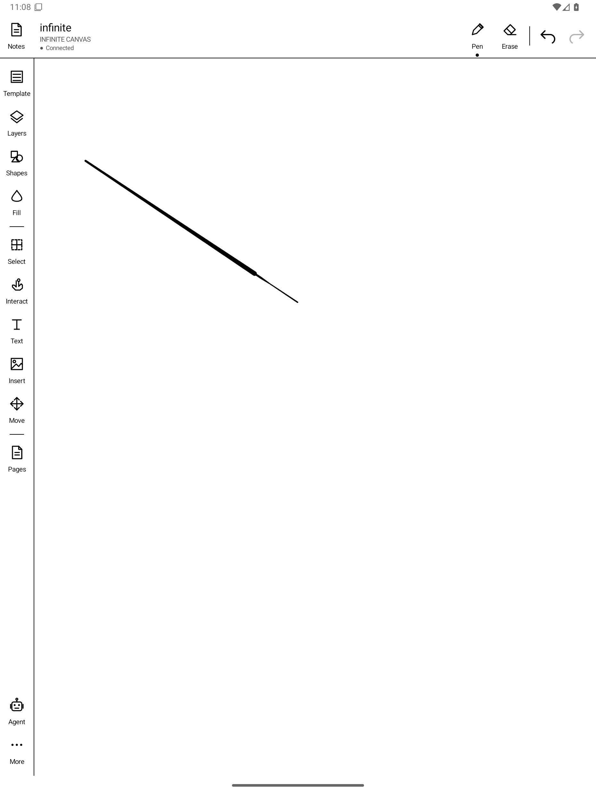
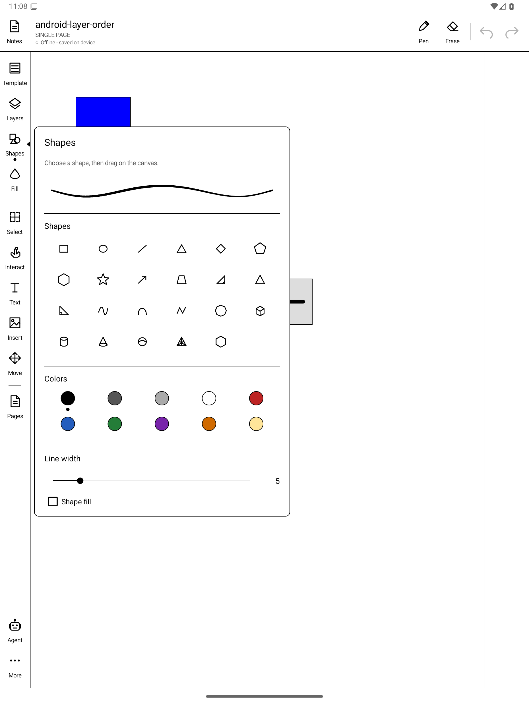
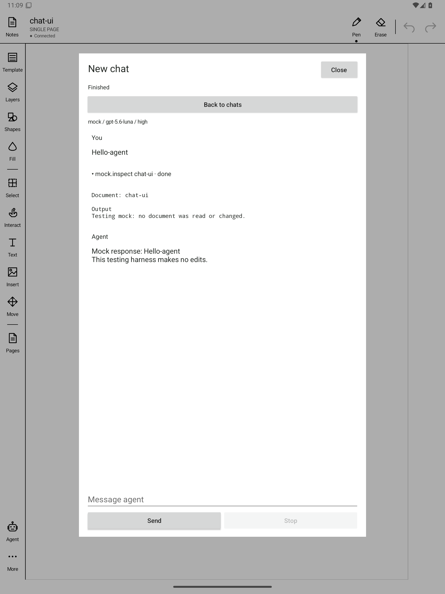

# NoteMaker

Note-taking and drawing for E Ink tablets (built for the BOOX Note Air6 C),
with an AI agent that can draw on your pages.

<p align="center">
  
  
  
</p>

## Quick start

```sh
nix-shell                      # all tooling comes from shell.nix
apps/android/build.sh          # → apps/android/build/notemaker.apk
python3 apps/server/server.py --port 8765 --database notemaker.sqlite3
boox-emulator                  # or connect a tablet over USB
adb install -r apps/android/build/notemaker.apk
python3 tests/run.py           # local tests
```

Full build, server, tablet, and test options: [docs/setup.md](docs/setup.md).

## What

| Part | Path |
| --- | --- |
| Tablet app (Rust over JNI, thin Java shim) | `apps/android` |
| `notemaker` CLI and local sync proxy (Rust; runs on PC and Android) | `apps/cli` |
| Home server: SQLite operation log, browser viewer, agent chats (Python) | `apps/server` |
| Shared replica, actions, history, rendering | `packages/core` |
| Tiered test runner | `tests` |

```
 Tablet app ──┐
              ├─► local proxy + replica ──(sync when online)──► home server
 CLI / agent ─┘     (durable, on-device)                         ├─► browser viewer
                                                                  └─► agent chats
```

The app has a canvas with tools for pen, eraser, shapes, text, selection,
layers, templates, and embedded SVGs and GIFs, plus a file browser and agent
chat. See the [app guide](docs/app-guide.md).

## Why

- **Offline first.** Tablets drop off Wi-Fi. Every edit lands in an on-device
  replica first, and a proxy syncs it when the server is reachable. Drawing,
  undo, and export never wait on the network.
- **Agents are just another editor.** The agent uses the same CLI as
  everything else, so its edits go through the same local state, get their
  own undo history, and land atomically (a whole diagram at once).
- **Everything is scriptable.** Every UI control also exists as a CLI
  command with JSON in and out. Agents and tests drive the real app this way.
- **Built for E Ink.** Few redraws, no animation, high contrast.
- **One Rust core.** The app and CLI share `packages/core`, so they render
  and resolve history the same way.

## More

- [Setup, build, and test](docs/setup.md)
- [App guide](docs/app-guide.md)
- [CLI reference](apps/cli/README.md)
- [Sync protocol](apps/server/PROTOCOL.md) ·
  [Agent chat protocol](apps/server/agent/PROTOCOL.md)
- [Architecture decisions](docs/adr)
