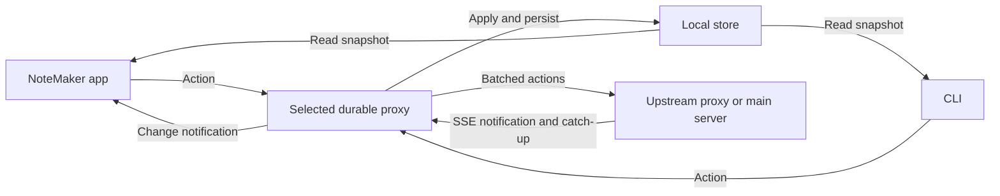

# ADR 0007: Durable proxy trees and event-driven synchronization

Status: accepted, 2026-10-13. Supersedes ADR 0004's standalone writers,
periodic replica polling, and direct editor mutations of Store.

## Context

Drawing produces bursts of actions separated by idle periods. Repeated sync
and editor polling perform unnecessary work. Apps and CLIs need one writing
boundary and inexpensive consistent local reads. Deployments may contain many
apps, CLI processes and durable proxies, connected through several proxy hops
to one main server. Editing must survive loss of that server.

## Decision

Each durable proxy exclusively owns a replica directory, enforced by a lifetime
file lock. All document writes, including the Android editor's raw pen actions,
go through its command boundary. Acknowledgements follow journal fsync. CLI
mutations require a selected proxy; an unavailable selected proxy fails writes.
The default Android selection is its embedded proxy. It can instead select
another reachable proxy using a URL and private bearer token; its spawned CLI
inherits that selection. AI chat remains a separate server API.

Direct local reads remain supported. Readers acquire the document lock, consume
only complete journal records, and never repair or truncate a journal. Only the
owner recovers incomplete tails. Readers can briefly lag but never see part of
an atomic action. The local editor retains in-process model access, incremental
action application and existing layer/ink caches. Remote editors read a
materialized snapshot rather than replaying full histories on every update.



Each proxy has at most one upstream for its documents. The upstream is either
the single main server or another durable proxy. New proxy links recursively
validate stable replica IDs, rejecting cycles and chains beyond 64 hops.
Validation publishes the proposed edge to other validators but prevents its
sync worker from using it before acceptance. Proxy ancestors must be reachable
when establishing a new edge. Existing edges remain configured during outages.
The selected upstream, stable proxy ID/token, and main-server identity are
persisted in private `proxy-config.json`. A replica cannot switch to a different
main-server database. Uploads carry any already known main-server identity, so
an unbound parent adopts it before acknowledging receipt. The config also keeps
the opened-document registry, including names missing from legacy baselines.
Chat API requests from Android are also sent to the selected proxy. Each proxy
forwards `/api/chats` requests, including the event stream, through its one
configured upstream; the primary server remains the chat database and worker.
This is transport forwarding only and does not replicate chat records into
proxy storage. Requests to a proxy require its bearer token. A proxy with no
upstream rejects chat requests with a message directing traffic through the
proxy. Forwarding-only proxies for arbitrary APIs remain deferred.

The main server alone commits the final action order. Each proxy maintains a
provisional arrival order for offline rendering. An append-only ingress log
lets children catch up provisional actions, including while the root is offline.
Acknowledgement by an intermediate proxy means durable receipt, not final
commit. The sender records that receipt to avoid resending already forwarded
actions, but retains them in its pending overlay until their final commits
arrive. IDs and contents make delivery retries idempotent. Existing actor undo
stacks stay local to the proxy where the actor edits; relaying actions does not
merge another proxy's undo stacks.

Replication protocol 3 has two paginated streams per document: main-server
commits and the upstream proxy's ingress log. Commit offsets count document
actions, independent of SQLite's legacy global sequence numbers. The root
identity is checked before upload and before applying downloaded commits.
Final commits preserve the existing geometry, visibility and conflict semantics.
An action is removed from the pending overlay in the same durable transaction
that applies its commit. Existing baseline histories migrate without changing
the server database or deleting notes.

A proxy has one synchronization worker. The first pending action starts a
500 ms window; subsequent actions do not postpone it. Upload starts are at least
500 ms apart across all documents, with one upload in flight. Batches have at
most 100 atomic actions and approximately 3 MB of action JSON. Transient failures
use exponential backoff from 500 ms to 30 seconds. `sync` requests use the same
worker and limits. An explicit configuration change can reset reconnect backoff.

Each proxy subscribes to its upstream's SSE notification stream. Stream opening
always triggers catch-up; durable cursors recover missed notifications, so SSE
event IDs are not relied upon for durability. Fifteen-second heartbeats keep the
stream live without reading documents. Reconnects back off. Proxies synchronize
documents opened locally or received from children, not every server document.
In-process editor readers use change notifications; remote editors use SSE.

## Consequences and limits

The supported topology is a tree (or temporarily disconnected forest) of durable
replicas rooted at one server. More hops add batching delay. Configuring a new
proxy edge while an ancestor proxy is unreachable fails, rather than accepting
an unverified cycle. Loopback listeners remain private; cross-device connections
use ADB/SSH tunnels and descriptors containing the reachable address.

History and ingress logs grow without compaction, and large snapshots still cost
memory proportional to the document. Android can evict the service or force-stop
the app. A local acknowledgement survives process restart; an unsaved pen preview
does not. Using a remote editing proxy requires connectivity to that proxy.
Disk loss, corrupted acknowledged storage, malicious peers, and server failover
are outside these guarantees. The browser retains its legacy read API.

The primary server must remain reachable for chat creation and agent runs.
Offline replica editing remains available, but chat requests are not cached or
queued by intermediate proxies.

## Verification

Run through `nix-shell` after building CLI and APK:

The tiered entry point and external-device checks are described in
[ADR 0008](0008-test-tiers.md). `python3 tests/run.py` runs local checks without
requiring a tablet; add `--tier local --tier emulator` for Android regression.

```sh
python3 tests/topology_properties.py
python3 tests/cli_checks.py
python3 tests/proxy_checks.py
python3 tests/server_checks.py
python3 tests/chat_checks.py
python3 tests/cli_android.py
python3 tests/integration.py
python3 tests/performance.py
```

Hypothesis generates real-process topology trees and concurrent action bursts,
partitions, lost responses, duplicated deliveries, proxy crashes and root-server
restarts. Properties cover acknowledged-action retention, action identity,
atomic direct snapshots, final-order replay and convergence. Targeted checks
cover cycles, ownership, offline provisional propagation, batching deadlines,
upload bounds and idle behavior. Android checks exercise real stylus dispatch,
app-spawned CLI writes, selected external proxy reads/writes, SSE refresh and
cached rendering. Results and hardware limitations belong in `docs/verification.md`.
