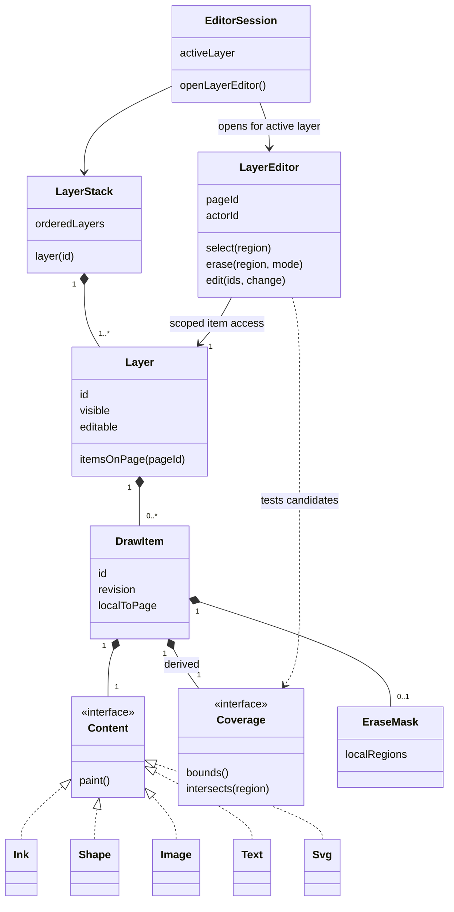

# ADR 0011: Unified drawn items and coverage

Status: accepted and implemented, 2026-10-14.

## Context

The model stores strokes and objects separately. Rendering knows pressure,
brush footprints, fills, image transparency and transforms, while interaction
has separate geometry approximations. Area erasing currently compares bounding
boxes. A shared area contract should make interaction match visible marks.

## Decision

Expose every stroke, shape, image, SVG and text object as a DrawItem in core.
Use composition: item identity, transform and revision are common; editable
content remains typed. The layer stack owns ordered layers, and each layer owns
its ordered item collection with page-scoped lookup. Items have no dependency on
the active layer or editor session. Each item has derived Coverage and an
optional persistent EraseMask in its local coordinates.

The editor session selects a layer from the stack and opens a LayerEditor bound
to that layer and page. Candidate lookup starts in that layer's collection or
spatial index; it never scans a document-wide item list to filter layer IDs.
Selection and modification operate only on items resolved through this scope.
For a selection lease request that already names item IDs, resolve each ID
directly against the scoped model and active flags instead of constructing all
drawn items in the layer. The proxy repeats this narrow check inside its atomic
coordination update so a concurrent edit cannot grant a lease to an item that
has left the editable layer or page. Geometric hit testing still uses DrawItem
coverage to decide which IDs the editor requests.
For a topmost hit, traverse the layer's established item order from the front
of the stack and construct DrawItem geometry only as each candidate is tested.
The first exact coverage hit wins; area and multi-item selection continue
collecting all exact hits in the same order.

Coverage is the support of the item's own rendered alpha after clipping and
erasure: alpha > 0, before compositing with the page or other items. White opaque
pixels count; transparent pixels do not. Holes and disconnected components are
valid. An unfilled circle covers its outline, not its interior. Ink covers the
actual pressure/brush footprint. Text covers glyphs; image coverage uses alpha
(a JPEG normally covers its entire rectangle). SVG coverage follows its paint.
Occlusion by other layers does not change an item's intrinsic coverage.

Bounds accelerate candidate lookup and position transform handles; they are
never the final hit test. Resolve page-space queries against transformed local
coverage, including rotation and nonuniform scaling. Use vector regions for
native geometry and bounded alpha tiles for raster content. Rendering and area
construction consume the same paint primitives in `Render`. JVM Area and Android
Path adapters implement vector geometry; text uses native glyph outlines. Images,
SVG assets and SVG-backed figure shapes use lazy 64×64 alpha tiles at one local
document unit per pixel, with alpha > 0 as the occupancy threshold. Empty/full
tiles use sentinels and mixed tiles use 512-byte bitsets. Each item caches at most
128 tiles; the LRU now retains 10,000 geometry variants. This is an entry limit,
not a 10 MB memory limit: worst-case mixed-tile payload alone could reach 625 MiB,
in addition to geometry, source assets and indexing overhead. Tiles remain lazy;
the measured vector-only workload does not allocate this worst case. Individual raster queries exceeding
16384 tiles fail explicitly. Asset decoding retains existing renderer limits.
Font metrics, SVG interpretation and antialiasing can differ across platforms;
coverage follows each platform's rendering, rather than claiming identical
subpixel edges or font outlines. The Android app and Android CLI share one backend.
Cache by local content, style, erasure and resolved connector geometry. Object
translation/rotation/reflection and stroke translation reuse local coverage.
Legacy stroke rotations/scales still rewrite points and rebuild coverage; object
resizing also changes local geometry. No full-page mask is allocated for infinite
canvases.

## Interaction rules

- Resolve the active layer once through the layer stack. Open a LayerEditor only
  for a visible, editable layer, and obtain page candidates from its own item
  collection. Apply existing collaboration lease rules and coverage tests to
  those candidates. Pick the topmost eligible hit. Other visible layers remain
  available to rendering but are outside this editor's item scope.
- App and CLI use the same layer-scoped editing entry point. CLI requests name
  the layer/page when opening that scope. Resolve direct item IDs only within
  its collection; an ID outside it fails resolution before modification. Resolve
  all batch targets before committing so failure leaves the batch untouched.
  Individual items, coverage implementations and modification algorithms never
  inspect a global active-layer value or repeat layer-membership checks.
- Switching layers clears selection and leases, cancels pending gestures and
  invalidates delayed selection responses using the existing generation counter.
  `Store.commitSelected` resolves the session's layer scope and leases under the
  transaction lock before generating modifications. Scope lifecycle and lease
  validation belong to the shared editing boundary, not to DrawItem. Replay of
  committed actions is independent of any session's current layer.
- Tap selection may use a small screen-space tolerance, converted through the
  viewport transform. Tolerance is an interaction aid, not stored coverage.
  Box/lasso selection uses coverage intersection. Transparent padding is ignored.
  A separate whole-item-containment selection mode is not exposed in this change.
- Whole-item erase removes each eligible item intersected by the swept eraser
  area. Partial erase subtracts that area through a local EraseMask for any
  content type, preserving editable source and item identity. Erased holes no
  longer hit-test. A mask follows the item's transforms; changing its source
  retains the mask unless explicitly reset. Entirely erased items have empty
  coverage and remain recoverable through undo/history.
- A diagram remains one atomic edit/undo batch across its items. This does not
  require replacing its nodes and connectors with a single bitmap.

All mutations continue through shared local state, offline operation, actor
history and conflict handling. `selection query` exposes coverage through the
CLI; selection, transforms, erasing and direct updates resolve within an explicit
layer/page scope (default base/0). Raw document import/replay operations retain
their document-wide purpose. `Model` retains the existing layer stack and builds
a layer/page item index lazily, updating it on snapshot replacement. `DrawItem`
adapts existing stroke/object records, retaining identity, ordering and journal
replay. The UML shows logical ownership; there is no second serialized layer stack.
Content variants remain validated protocol snapshots rather than a second set of
serialized Java subclasses. DrawItem resolves connector geometry when adapting a
snapshot and retains no reference to the document or editor session.

New partial erasing stores local polygon contours in `erasures`. Swept round
segments are tessellated with approximately 0.1-unit chord error (capped at 512
steps per semicircle). Object masks use normalized unrotated coordinates; stroke
masks use first-point-relative coordinates, transformed with their points.
Native clipping, SVG export clip paths and browser canvas clips subtract the
same contours. They never clear pixels belonging to underlying layers. Limits
are 2000 contours, 4096 vertices per contour and 64000 vertices per item, within
existing atomic action-size limits. Source edits retain masks; an empty mask
array resets them. Flood fill respects erased boundary gaps.

This supersedes ADR 0009's partial-erase fragment creation for new gestures.
Old eraser actions still replay unchanged. Masks require compatible app, CLI,
proxy and server/viewer versions; older renderers can display erased source.
The durable transport remains version 3. No remote deployment is implied.

## Examples and verification

See [two interaction mockups](../design/unified-items-mockups.svg). Dashed image
bounds are explanatory overlays; the silhouette is the selectable area.

`tests/coverage_checks.py` uses actual offline CLI calls for transparent image
holes, opaque white pixels, hollow shapes, pressure ink, transforms, masks,
layer scope, empty coverage, text, undo/redo and restart persistence.
`drawing_browser` checks exported and server-rendered pixels after partial image
erasing. `drawing_android --coverage-only` checks Android vector/alpha coverage,
underlying-layer pixels and layer-switch lease release on an isolated emulator.
Existing drawing, collaboration and conflict suites cover their shared paths.
Executed results are recorded in `docs/verification.md`. Physical E Ink/stylus
behavior and a remote server rollout remain untested.

### Performance follow-up — 2026-10-14

Physical-tablet profiling on a disposable copy of an existing note found that
`DrawItem.intersects` requests exact coverage before rejecting distant items by
bounds. Android coverage builds incrementally union each stroke segment and dot;
a layer scan exceeding the 16-item coverage cache rebuilds those unions on later
gestures. On the measured layer, 36 active items with 3,296 ink points required
about 1.25 seconds per erase. This work runs inside the document transaction and
on the app's single write queue, allowing queued input to exceed five seconds.
The implemented follow-up rejects distant candidates before exact coverage,
retains 10,000 recent coverage variants, packs stroke primitives into double
arrays, and constructs native query geometry only for nearby primitives. Native
paths are no longer incrementally unioned for ink. A separate 10,000-entry
identity cache retains bounds and local coordinates for immutable published
snapshots. Eviction and source replacement rebuild derived data; neither cache
stores selected-layer state. Rejected edits retain valid Journal materialization.

Android reuses SVG Pictures (64 entries) and its existing three display-sized
layer bitmaps for both objects and ink. Edits repaint the connected region of
overlapping paint bounds to preserve antialias pixels. In-process snapshots retain
model indexes; HTTP JSON and the durable journal format are unchanged.

Pending erase feedback is a scoped visual prediction on gesture release. Partial
erase clips only the target layer; whole-item erase temporarily hides exact-hit
candidates. The shared proxy still validates and journals the action. Success
replaces the preview with authoritative state, and rejection removes it. A foreign
lease suppresses prediction; a late lease is checked again by the actual command.
Published model content remains immutable; prediction never changes actor history.

The compact coverage cache measured 41.8 MiB for 10,000 distinct 20-point strokes,
excluding prepared snapshots, document/history, image assets and display caches.
The native-path experiment used 220.2 MiB and is preserved on a separate branch.
Entry caps are deliberately not described as a total byte budget. Under 30 ms
is approached for partial feedback, but is not achieved for every erase or for
durable completion. See the [latency report](../design/latency/report.md) for
measurements, branches, limits and reproducible charts.

## Update 2026-11-02

The Java implementation described here was ported one-to-one to Rust and
removed (ADR 0026 CLI, ADR 0029 Android app, `docs/design/rust-port.md`).
The decision stands; JVM, `app_process`, jsvg/androidsvg and `.java` details
now refer to their Rust equivalents (native CLI binary, resvg).
