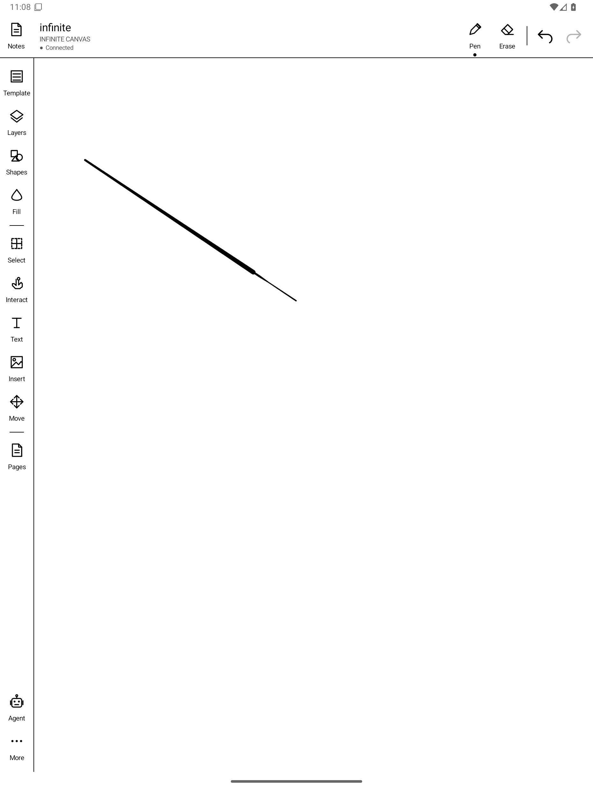
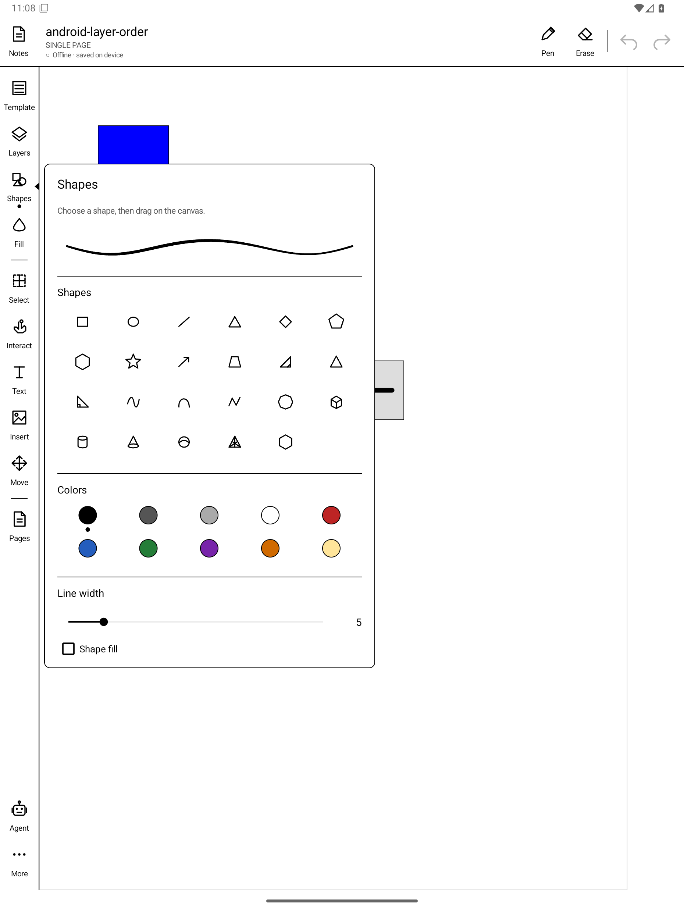
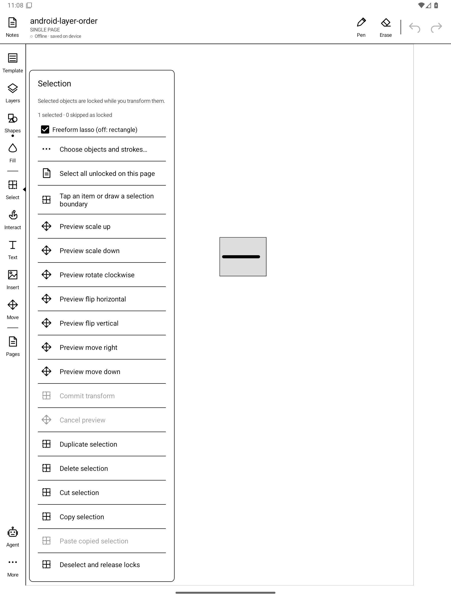
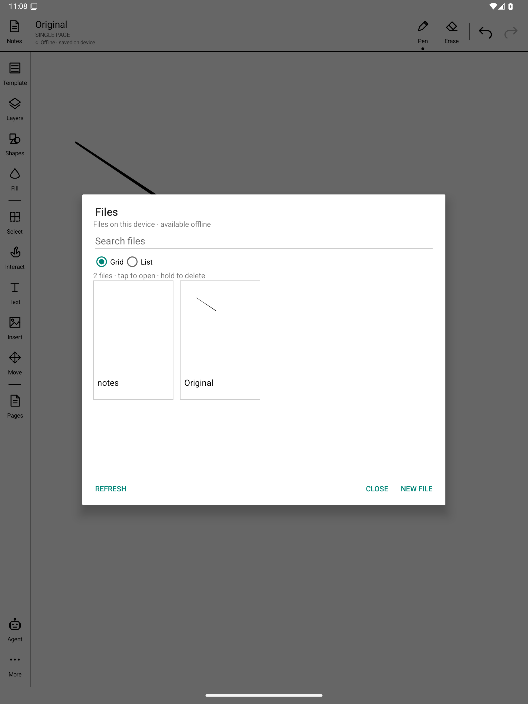
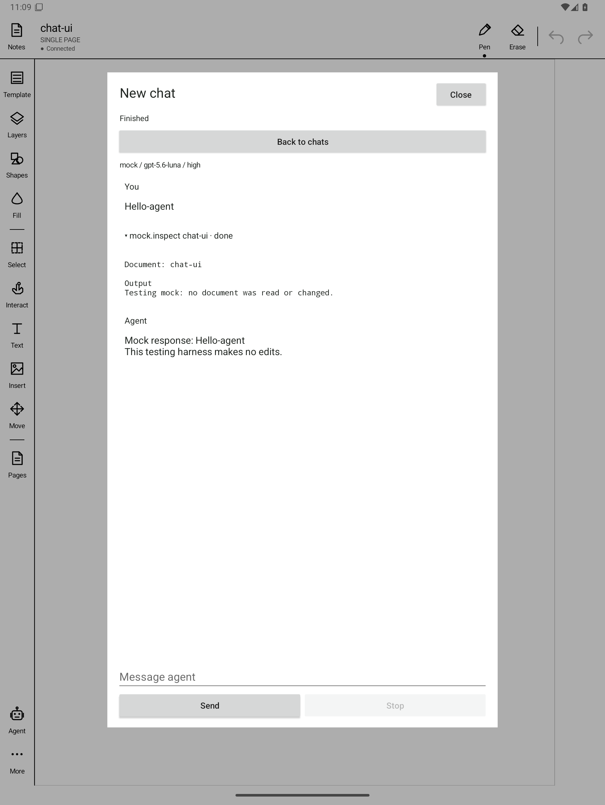
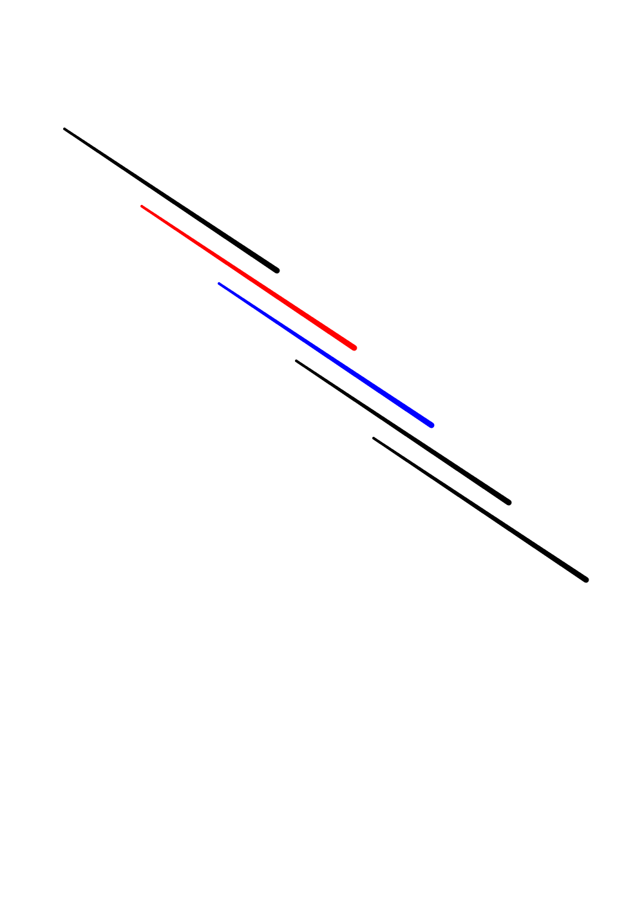

# App guide

## Editor

The main screen is a canvas with a tool rail on the left and pen, eraser,
undo, and redo across the top. Documents are **single page** or an
**infinite canvas**. The status line shows `Connected`, or
`Offline · saved on device` when the server can't be reached.

  
  
  

| Tool | Does |
| --- | --- |
| Template | Page backgrounds, including procedural infinite templates |
| Layers | Add, reorder, hide, and lock layers |
| Shapes | 2D and 3D shapes, color palette, line width, fill |
| Fill | Fill closed regions |
| Select | Lasso/rectangle select; scale, rotate, flip, move, duplicate, cut, copy, paste, delete. Selected items are locked while transformed. |
| Interact | Use embedded objects such as GIFs and SVGs |
| Text | Place and edit text |
| Insert | Insert SVGs and images |
| Move | Pan the viewport |
| Pages | Page navigation |
| Agent | Open the AI chat panel |
| More | Additional settings |

## Files

**Notes** opens a document browser: grid or list view, search, thumbnails,
new file, and hold-to-delete. All files are available offline.

  

## Agent chat

The **Agent** panel runs chats on the home server through the Pi coding
agent, with a provider, model, and effort chosen per chat. The agent edits
through the same CLI and proxy path as the app, so its changes get their own
undo history.

  

## Browser viewer (PC)

The server hosts a LAN viewer at `http://<server>:8765/` that shows documents
live as the tablet or agents edit them.

  

