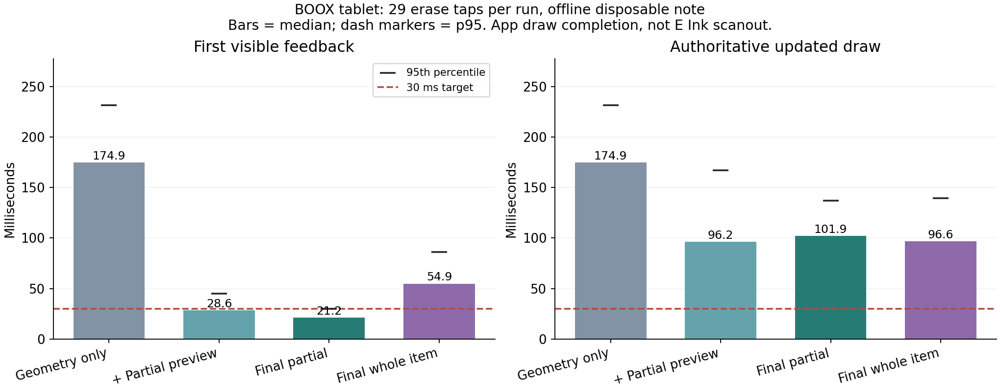
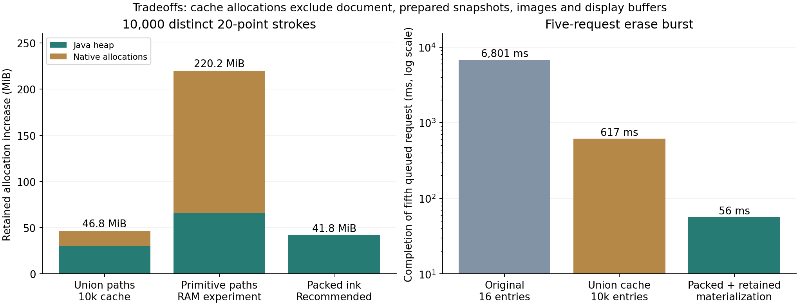

# Drawing latency experiments — 2026-10-14

The multi-second erase backlog was reproduced and removed in the measured
workload. Partial erase feedback now takes about 16–21 ms median on the physical
BOOX tablet. **The under-30-ms goal is not met for all operations:** partial
feedback p95 is 30–32 ms, whole-item feedback is slower, and durable completion
still takes roughly 85–102 ms median. E Ink scanout was not measured.

## Measurement and scope

The source was a read-only capture of the user's example note. Its selected
layer contains 36 active items and 3,296 stroke points; another layer contains
an SVG. All measured edits used disposable copies. The isolated Android package
has its server disconnected, an ephemeral proxy port and a separate data
directory. Each UI run taps the midpoint of 29 strokes through the real canvas
input handler, waits for updated content, then undoes the edit. Final tests
assert that source geometry and effective visibility are restored. Undo may
replace an absent active flag with an explicit true flag; these are equivalent.

The tablet reports 40 Hz (25 ms frame scheduling). Feedback timing starts at
synthetic DOWN and ends at the first completed app draw showing the preview;
the tap immediately sends MOVE/UP. This excludes physical pen sampling and
panel scanout. Prediction starts on gesture release, not continuously on MOVE.
Authoritative timing includes the proxy command, journal sync, snapshot refresh
and updated draw. Long real gestures and worst-case 10,000-item interaction
latency have not been established by this 36-item note benchmark.

| Physical tablet run (29 operations each) | Feedback median / p95 | Authoritative draw median / p95 | Feedback under 30 ms |
| --- | ---: | ---: | ---: |
| Compact backend, original redraw | 174.9 / 231.4 ms | 174.9 / 231.4 ms | 0/29 |
| Initial partial prediction | 28.6 / 44.7 ms | 96.2 / 167 ms | 17/29 |
| Final partial, first run | 15.7 / 32.0 ms | 85.2 / 124.4 ms | 26/29 |
| Final partial, repeat | 21.2 / 30.1 ms | 101.9 / 137.2 ms | 27/29 |
| Final whole-item, first run | 52.5 / 74.8 ms | 98.4 / 116.9 ms | 7/29 |
| Final whole-item, verified repeat | 54.9 / 86.2 ms | 96.6 / 139.3 ms | 4/29 |

These are small sequential runs, not confidence intervals. CPU scheduling,
allocation and frame phase vary. The chart uses the final repeat runs, including
the slower whole-item result, rather than choosing the fastest run. p95 uses
nearest rank. Earlier backend probes run in standalone `app_process` under a
separate actor; their single-digit command times must not be presented as UI
latency with the real actor history.

## Methods that worked

1. **Retain coverage, reject by bounds first.** The original 16-entry cache
   thrashed over 36 items. Incrementally unioning hundreds of native paths took
   about 1.25 seconds per erase. A 10,000-entry cache alone reduced warm repeated
   proxy erases to 6.8–7.3 ms, but retained the approximately 1.3-second cold cost.
   Bounds rejection and packed ink primitives remove that union construction.
   Exact native intersection remains the final hit test; layer candidate lookup
   stays in `LayerEditor`.
2. **Keep materialization after rejected edits.** A no-match erase discarded the
   in-memory journal state and forced replay on the next queued edit. A burst of
   five requests originally completed after 6,801 ms. Caching alone reduced this
   to 617 ms; packed geometry plus retaining materialization reduced it to 56 ms.
   Actual I/O failures still invalidate the materialization.
3. **Reuse display work.** Settled layer bitmaps now include objects, and edits
   repaint only affected overlapping paint bounds. SVGs retain recorded drawing
   commands instead of repeatedly traversing parsed SVG trees. Exact bitmap
   comparisons cover fractional transforms, translucent overlaps, erasing,
   deletion, insertion, order, undo and object changes. A mask-only damage
   experiment produced antialias differences and was corrected before adoption.
4. **Avoid conversions and rebuilding indexes.** Settled rendering uses native
   maps, JSON writes into one builder, and in-process proxy snapshots retain
   Model indexes. Remote JSON transport remains compatible.
5. **Show reversible pending feedback.** Partial feedback clips the affected
   layer immediately while the proxy persists the atomic action. Whole-item
   feedback hides exact-hit candidates, which requires more geometry and redraw
   work. Rejection removes the prediction; late-lock rollback is tested.

SVG Picture caching and the combined raster cache improved feedback in successive
runs, but those runs do not isolate each change from scheduling variation. Their
individual contribution is less certain than the large backend/cache effect.
Ahead-of-time `speed` compilation did not help: its tested authoritative median
was 112.8 ms and p95 166.1 ms. It is not required by the deployment.

## Memory tradeoffs

| Coverage representation | Java heap increase | Native allocation increase | Total increase |
| --- | ---: | ---: | ---: |
| Cached union paths | 30.0 MiB | 16.8 MiB | 46.8 MiB |
| Individual native primitives | 65.8 MiB | 154.4 MiB | 220.2 MiB |
| Packed ink primitives, recommended | 41.8 MiB | 0.02 MiB | 41.8 MiB |

Measurements retain 10,000 distinct synthetic 20-point strokes, with GC before
reading Java heap and Android native allocated bytes. They measure coverage-cache
allocation above an empty-cache baseline, not total process RAM or all possible
item sizes. Source maps, boxed point coordinates and indexes make even small
strokes larger than 1 kB. Longer strokes and masks grow further.

The product retains up to 10,000 recent coverage variants and 10,000 prepared
snapshot identities, rather than eagerly building every coverage at startup.
Old edited versions may occupy entries until eviction. Prepared snapshots,
document/history, decoded assets and display buffers are additional memory.
The display uses at most three viewport-sized ARGB layer bitmaps, about
`3 × width × height × 4` bytes, plus existing thumbnails. SVG Pictures retain
up to 64 source/size variants and may also retain embedded assets.

Raster masks are lazy 64×64 binary tiles, up to 128 tiles per cached coverage.
The 10,000-entry cap is not a global byte limit: worst-case mixed-tile payload
alone could reach 625 MiB. The vector-only memory probe does not exercise that
case. A global byte budget is a useful follow-up for image-heavy notes.

## Branches, checks and remaining work

The initial work was checkpointed on `main` as `c4d193f`. Experiments remain:

| Branch | Purpose |
| --- | --- |
| `perf/cache10000-unions` (`dd507c2`) | Larger cache with original union geometry |
| `perf/parts10000` (`dabcf1e`) | Fast native primitives, high RAM experiment |
| `perf/compact-backend` (`7a7fe64`) | Packed ink and backend probes |
| `perf/compact-coverage` (`1bbc2d2`) | Prepared geometry, partial preview and redraw work |
| `perf/svg-display-cache` | Recommended implementation, final checks and charts |

Checks run through `nix-shell`: CLI 18, coverage 11, drawing tools 9, selection
20, proxy 9, conflicts 6, browser export/render check, Android coverage/pixel/
late-lock rollback and editor panels. Physical Android parity compares 8,700
queries over brushes, masks, shapes, transforms, text and SVG: both original and
optimized implementations yield 2,745 hits and SHA-256
`884efef226477927b9a95463f3aa9297468562a4cf92b824e5a09c43e30a42ca`.

The 1,000-stroke API 36 emulator regression also passed: input-to-draw p95
stayed between 16.79 and 16.88 ms across the beginning, middle and end windows,
with zero full ink-cache rebuilds, maximum save queue depth 1, and 732 ms final
drain. All strokes survived restart, and incremental replay and cached/uncached
canvas comparisons matched. These are emulator stylus events, not BOOX pen or
E Ink measurements.

The recommended build was installed on the physical tablet after testing.
The backup/upgrade check preserved all 49 data/settings files and 358 actions;
the app reconnected to its configured server with zero pending actions. This is
a connected smoke check, not a second connected latency benchmark. Detailed
installation evidence is in `docs/verification.md`.

The remaining target gap is primarily whole-item hit-testing/redraw and the
atomic action validation, serialization, sync and scheduling path. Further work
should preserve durability while reducing repeated action/history validation and
whole-item prediction work. Physical display latency needs camera or photodiode
measurement; emulator and app draw timings cannot establish it.

## Reproduce

See the README's latency commands. Run `nix-shell --run 'python3
tests/plot_drawing_latency.py'` to regenerate PNG/SVG charts from committed,
sanitized `measurements.json`. Add `--raw .test-artifacts/latency` to import the
named experimental runs. Raw captures and output directories contain private
note content and stay ignored; the published JSON contains timing/allocation
numbers only. Cache construction wall times include memory-probe pauses and
are intentionally not plotted as pure construction CPU time.
