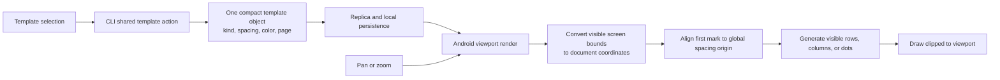

# Infinite canvas template rendering

The dot, grid, and ruled guides on an infinite canvas are stored as one small
template object. The Android renderer generates only the marks intersecting the
current viewport; panning or zooming recomputes those marks from document
coordinates. A density floor limits dots and lines at far zoom levels.

The renderer avoids a canvas-sized bitmap and avoids storing per-mark geometry.
The visible dot count is capped at roughly 3,000 marks, and grid/rule spacing
also stays at least five screen pixels apart. Fixed and paged templates continue
to use their existing SVG representation.
